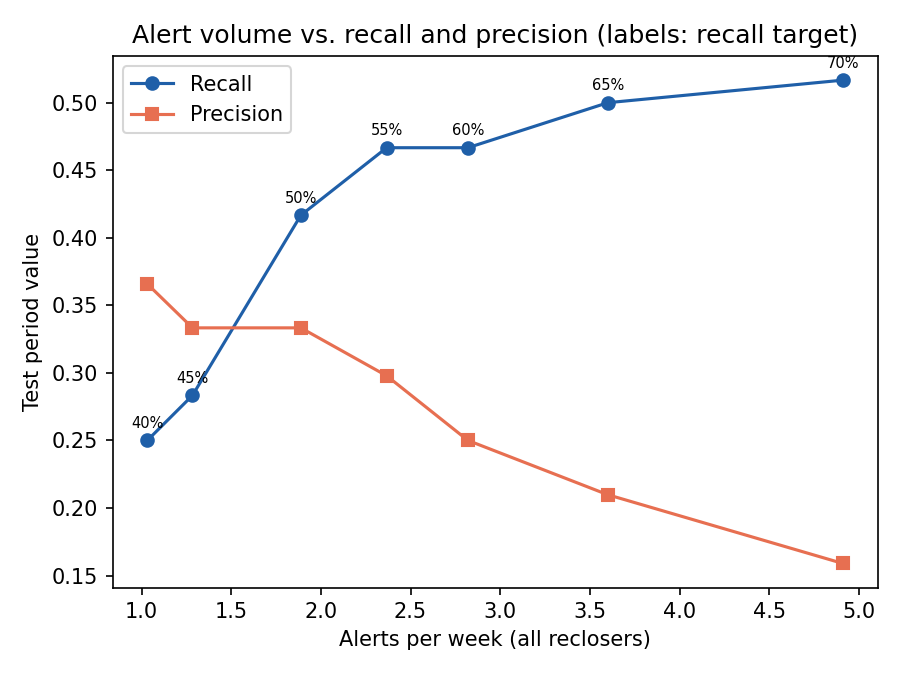
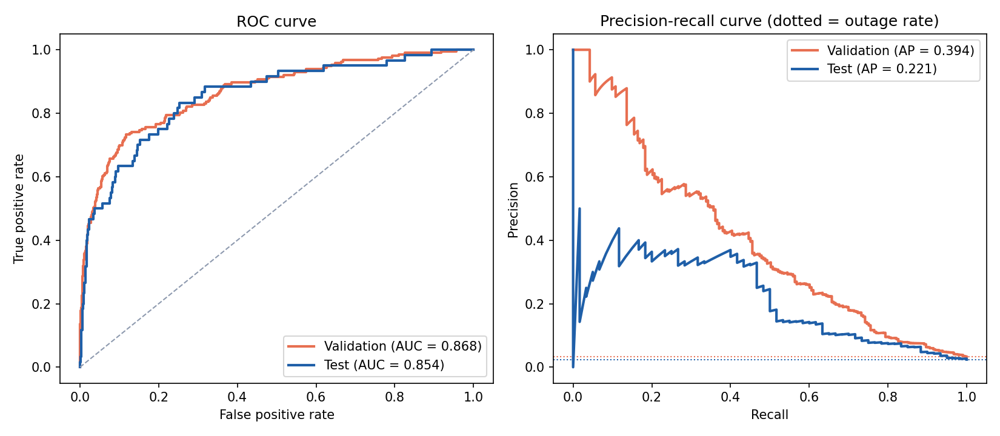
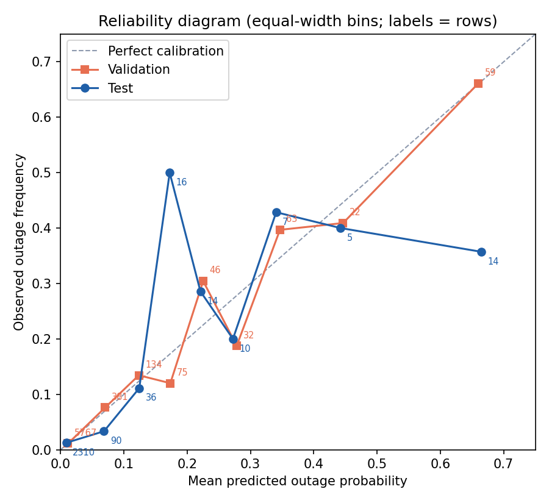
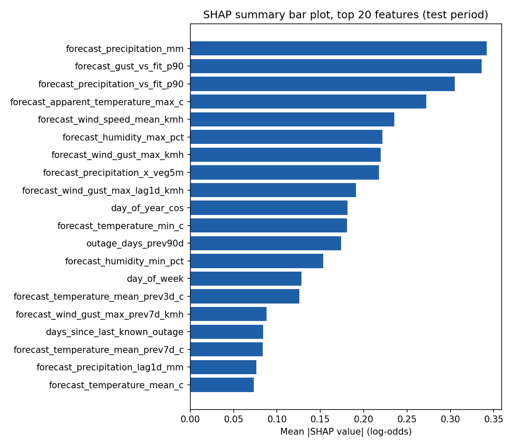
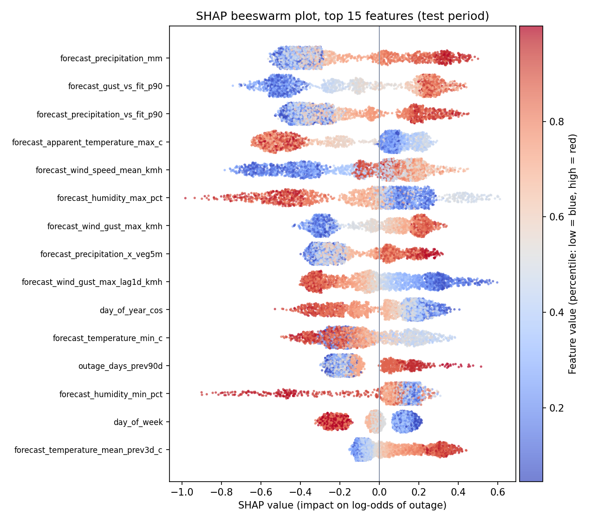
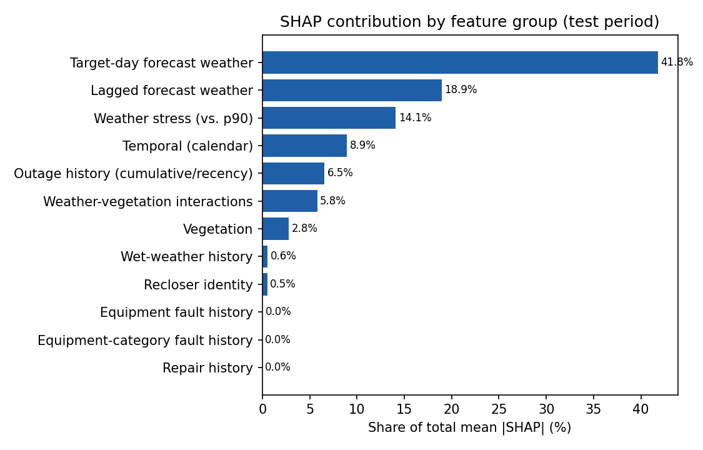
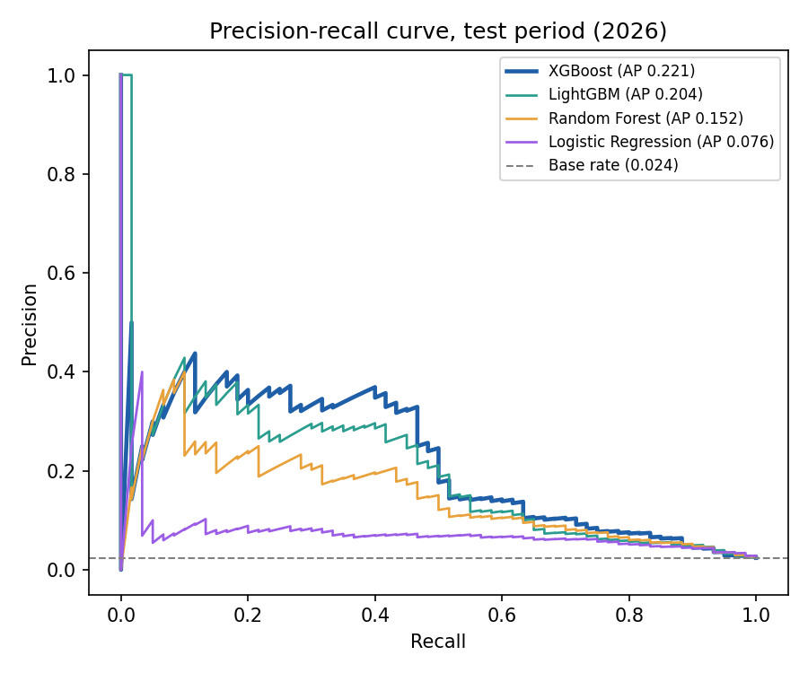
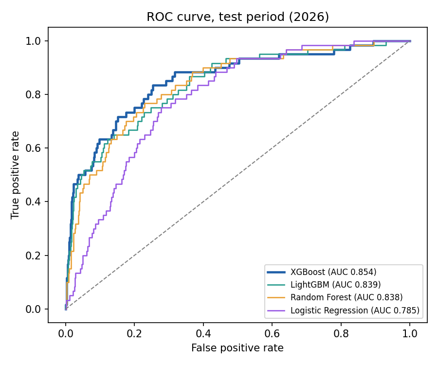

# CHAPTER V — RESULTS AND DISCUSSION

This chapter presents the results of developing and evaluating the XGBoost-based outage probability
forecasting model for Puerto Princesa City. The results are organized according to the research
objectives: dataset characteristics, model development and optimization (Objective 1), predictive
performance and probability calibration (Objective 2), SHAP-based feature interpretation (Objective 3),
and the contribution of engineered features (Objective 4). The chapter ends with a discussion of the
findings in relation to the reviewed literature.

> **Source of all numbers.** Every value in this chapter is produced by `train.py` and
> `chapter5_analysis.py` in this folder. Tables are saved in `reports/` and `reports/chapter5/`.
> Bracketed text such as **[insert …]** marks information that does not appear in the thesis manuscript
> and has to be filled in from the cited papers.

---

## 5.1 Dataset Summary

The final dataset contained 13,473 recloser-day records across nine reclosers in Puerto Princesa City,
from 31 August 2022 to 5 October 2026. Of these, 418 records were labeled as outages and 13,055 as
non-outages, giving an outage prevalence of 3.10%.

**Table 5.1 Summary of the Final Dataset**

| Characteristic | Value |
|---|---|
| Covered reclosers | 9 |
| Period covered | 2022-08-31 to 2026-10-05 |
| Total records (recloser-days) | 13,473 |
| Outage records (y = 1) | 418 |
| Non-outage records (y = 0) | 13,055 |
| Outage prevalence | 3.10% |
| Class ratio (non-outage to outage) | 31.2 : 1 |
| Input features | 66 |
| Model input columns (after one-hot encoding of the recloser) | 74 |

Table 5.1 shows that outages were uncommon in the final dataset: about one outage for every 31
non-outage recloser-days. This class imbalance is why the model was evaluated with precision, recall,
F1-score, ROC-AUC, average precision (PR-AUC) and the Brier score rather than accuracy. A model that
always predicted "no outage" would be 96.9% accurate while detecting no outage at all.

**Table 5.2 Data Split**

| Set | Period | Rows | Proportion | Outage rows | Outage prevalence |
|---|---|---|---|---|---|
| Training (initial window) | 2022-08-31 to 2023-12-31 | 4,392 | 32.6% | 145 | 3.30% |
| Validation (four rolling half-year folds) | 2024-01-01 to 2025-12-31 | 6,579 | 48.8% | 213 | 3.24% |
| Testing (held out) | 2026-01-01 to 2026-10-05 | 2,502 | 18.6% | 60 | 2.40% |

Table 5.2 shows the data used for training, validation, and testing. The split is strictly
chronological, so no future information is used to predict the past. Validation used rolling-origin
cross-validation: the 2024–2025 period was divided into four half-year folds, and each fold was predicted
by a model trained only on the data before it (Table 5.2b). The pooled out-of-fold predictions of the
four folds formed the validation set. That set was used to tune the hyperparameters, fit the probability
calibration and select the warning threshold. The final model was then retrained on all data before 2026,
and the test set (January to October 2026) was kept untouched until the final evaluation.

**Table 5.2b Rolling Validation Folds**

| Validation fold | Training rows | Training outages | Validation rows | Validation outages | Validation prevalence |
|---|---|---|---|---|---|
| 2024-01 to 2024-06 | 4,392 | 145 | 1,638 | 63 | 3.85% |
| 2024-07 to 2024-12 | 6,030 | 208 | 1,656 | 60 | 3.62% |
| 2025-01 to 2025-06 | 7,686 | 268 | 1,629 | 38 | 2.33% |
| 2025-07 to 2025-12 | 9,315 | 306 | 1,656 | 52 | 3.14% |

Outage prevalence decreased from 3.30% in the initial training window to 2.40% in the test period. The
test set contains only 60 outages, so a single additional detected or missed outage changes test recall
by about 1.7 percentage points. The pooled validation set has 213 outages, where one outage is worth
about 0.5 percentage points.

---

## 5.2 Feature Engineering Results

The XGBoost model used 66 input features. Table 5.3 groups them by the information they represent and
lists representative variables.

**Table 5.3 Feature Groups Used in the Model**

| Feature group | Count | Examples |
|---|---|---|
| Target-day forecast weather | 14 | `forecast_precipitation_mm`, `forecast_wind_gust_max_kmh`, `forecast_temperature_max_c`, `forecast_humidity_mean_pct` |
| Lagged forecast weather | 12 | `forecast_precipitation_lag1d_mm`, `forecast_precipitation_sum_prev3d_mm`, `forecast_wind_gust_max_prev7d_kmh` |
| Wet-weather history | 3 | `forecast_wet_days_prev3d`, `forecast_wet_days_prev7d`, `forecast_consecutive_wet_days_capped7` |
| Weather stress (relative to 90th percentile) | 2 | `forecast_precipitation_vs_fit_p90`, `forecast_gust_vs_fit_p90` |
| Vegetation | 6 | `veg_buffer_5m`, `veg_buffer_15m`, `veg_buffer_30m`, `ndvi_mean_brgy`, `ndvi_p90` |
| Weather–vegetation interactions | 2 | `forecast_gust_x_veg5m`, `forecast_precipitation_x_veg5m` |
| Outage history (cumulative / recency) | 8 | `outage_days_prev3d` … `outage_days_prev90d`, `days_since_last_known_outage` |
| Equipment fault history | 2 | `equipment_fault_days_prev7d`, `equipment_fault_days_prev14d` |
| Equipment-category fault history | 8 | `line_damage_days_prev7d`, `jumper_fault_days_prev14d`, `transformer_fault_days_prev7d` |
| Repair history | 2 | `repair_notice_days_prev7d`, `repair_notice_days_prev14d` |
| Temporal (calendar) | 6 | `day_of_week`, `is_weekend`, `day_of_year_sin/cos`, `month_sin/cos` |
| Recloser identity | 1 | `recloser` (one-hot encoded into 9 columns) |
| **Total** | **66** | |

Weather information makes up 31 of the 66 features (target-day, lagged, wet-weather history and weather
stress), and 2 more combine weather with vegetation. Twenty features describe the recent history of
outages, equipment faults and repairs for each recloser. Every history feature counts only events before
the target day, so the model never sees the outcome it is predicting.

The dataset had no missing values and no duplicate recloser-days, so no imputation was needed. The
infrastructure features are sparse. At least one equipment fault in the previous 14 days occurs on 10.0%
of recloser-days, an equipment-category fault on 7.2%, and a repair notice on only 0.2% (28
recloser-days).

---

## 5.3 Model Development and Optimization (Objective 1)

The XGBoost model was optimized by random search over 25 hyperparameter combinations. Each combination
was scored by its mean PR-AUC across the four validation folds. PR-AUC was used as the selection criterion
because it focuses on how well the rare outage days are ranked. The search also tested how strongly to
weight the outage class (`scale_pos_weight`): no weighting, the square root of the class ratio, or the
full class ratio (about 30).

**Table 5.4 Selected XGBoost Hyperparameters**

| Hyperparameter | Search range | Selected value |
|---|---|---|
| Number of trees (`n_estimators`) | 150, 250, 400, 600 | 250 |
| Learning rate | 0.01–0.05 | 0.05 |
| Maximum tree depth | 2–5 | 4 |
| Minimum child weight | 1–20 | 12 |
| Row subsample | 0.6–0.9 | 0.6 |
| Column subsample per tree | 0.4–0.9 | 0.75 |
| L1 regularization (`reg_alpha`) | 0–3 | 0.5 |
| L2 regularization (`reg_lambda`) | 1–15 | 15 |
| Minimum split loss (`gamma`) | 0–1 | 1.0 |
| Outage-class weighting (`scale_pos_weight`) | none / √ratio / full ratio | none (1.0) |

The selected configuration reached a mean validation PR-AUC of 0.434 with one random seed, and 0.431
when averaged over the three seeds used for the final model. The search favoured shallow, strongly
regularized trees, which suits the small number of outage events (358 before 2026).

Weighting the outage class did not help. The 10 configurations without weighting averaged a validation
PR-AUC of 0.415, against 0.405 for √ratio weighting and 0.403 for full-ratio weighting. Heavy weighting
mainly inflates the predicted probabilities, which calibration would have to undo. The class imbalance was
therefore handled through the choice of evaluation metrics, probability calibration and the warning
threshold, rather than through reweighting.

The final model averages three XGBoost models trained with different random seeds (42, 7 and 2024).
Their predictions are then calibrated with Platt scaling, which was fitted on the validation predictions.

**Figure 5.3 Recall, Precision and Alert Volume at Different Warning Thresholds**

The warning threshold was set to the value that maximized F1-score among thresholds whose validation
recall fell between 52% and 68%, which reflects the study's priority on recall. The resulting threshold
is a calibrated probability of **0.122**. Figure 5.3 and `reports/threshold_tradeoff.csv` show how
recall, precision and the number of alerts change for other thresholds.

---

## 5.4 Predictive Performance of the Model (Objective 2)

**Table 5.5 Model Performance on Validation and Test Sets**

| Metric | Validation (2024–2025) | Test (2026) | Benchmark (Section 4.8) | Met |
|---|---|---|---|---|
| Precision | 0.306 | 0.329 | — | — |
| Recall | 0.521 | 0.467 | priority metric | — |
| F1-score | 0.385 | 0.386 | ≥ 0.60 | **Not met** |
| AUC-ROC | 0.868 | 0.854 (95% CI 0.795–0.901) | ≥ 0.75 | **Met** |
| Brier Score | 0.0244 | 0.0212 | < 0.25 | **Met** |
| Average precision (PR-AUC) | 0.394 | 0.221 (95% CI 0.136–0.362) | — | — |
| Specificity | 0.960 | 0.977 | — | — |

*Validation precision, recall, F1 and Brier are in-sample with respect to calibration and threshold
selection, which were fitted on the same validation predictions. The test set is fully held out. The 95%
confidence intervals come from a day-block bootstrap (1,000 resamples of whole days).*

Table 5.5 shows that the model **met the AUC-ROC benchmark** on both validation (0.868) and test (0.854).
The lower end of the test confidence interval (0.795) also stays above 0.75. The model therefore
separates outage days from non-outage days well.

The **Brier score benchmark was met** by a wide margin (0.021 on test). However, with an outage rate of
2.4%, even a model that always predicts the outage rate scores 0.023. The 0.25 benchmark is therefore easy
to meet, and the Brier skill score in Section 5.5 is the more informative measure.

The **F1-score benchmark of 0.60 was not met**: F1 was 0.385 on validation and 0.386 on test. F1 depends
strongly on the outage rate. At a 2.4% prevalence, an F1 of 0.60 would require, for example, catching 60%
of outages while 60% of alerts were correct. That combination was not achievable here, because a large
share of outages occurred on days that looked ordinary in the available data (Section 5.8). Precision and
recall were nevertheless very similar on validation and test, which suggests the model generalized
consistently to the unseen 2026 period.

PR-AUC was lower on test (0.221) than on validation (0.394). PR-AUC rises and falls with the outage rate,
and the test year had fewer outages (2.40% vs 3.24%). The threshold-independent ROC-AUC, which does not
depend on prevalence, stayed stable (0.868 vs 0.854). Relative to the test outage rate of 0.024, a PR-AUC
of 0.221 is about **9.2 times** better than random ranking.

**Figure 5.1 ROC and Precision–Recall Curves of the Model**

Figure 5.1 shows the ROC curves (left) and precision–recall curves (right) for validation and test.
Both ROC curves rise steeply at low false-positive rates, so the highest-risk predictions are mostly real
outages. The precision–recall curves stay well above the outage rate (dotted lines) up to a recall of
about 50%. Beyond that, precision falls towards the base rate, because the remaining outages receive
probabilities similar to normal days.

**Table 5.6 Confusion Matrix on the Test Set (threshold = 0.122)**

|  | Predicted: No Outage | Predicted: Outage |
|---|---|---|
| **Actual: No Outage** | TN = 2,385 | FP = 57 |
| **Actual: Outage** | FN = 32 | TP = 28 |

Table 5.6 shows that in 2026 the model raised 85 alerts across 2,502 recloser-days, about 2.1 alerts
per week across all nine reclosers. Of these, 28 were real outages (precision 32.9%), and 28 of the 60
outages were detected (recall 46.7%). The model correctly stayed quiet on 2,385 of the 2,442 non-outage
recloser-days (specificity 97.7%). Thirty-two outages were missed, most of them on days with low
predicted risk (Section 5.8).

---

## 5.5 Probability Calibration (Objective 2)

**Table 5.7 Brier Scores and Brier Skill Score**

| Set | Raw Brier | Calibrated Brier | Baseline Brier* | Brier skill score (raw) | Brier skill score (calibrated) |
|---|---|---|---|---|---|
| Validation | 0.0245 | 0.0244 | 0.0313 | 0.217 | 0.222 |
| Test | 0.0210 | 0.0212 | 0.0234 | 0.102 | 0.094 |

\*Baseline = always predicting the set's own outage rate. The Brier skill score (BSS) is
1 − Brier / Baseline Brier; 0 means no better than the baseline and 1 is perfect.

Table 5.7 shows that the model's probabilities beat the outage-rate baseline on both sets: 22% better on
validation and 9–10% better on test. Calibration changed the Brier score very little. Because the selected
model uses no class weighting, its raw probabilities were already close to the observed outage rates. The
fitted Platt scaling (slope 1.15, intercept 0.36 on the log-odds scale) mostly applies a small correction.
On average, the calibrated test probabilities (2.17%) were close to the observed test outage rate (2.40%),
slightly underestimating it in a lower-outage year.

**Figure 5.2 Reliability Diagram of Predicted Outage Probabilities**

Figure 5.2 compares the mean predicted probability in each probability bin with the observed outage
frequency. Bins are equal-width, and the labels show the number of recloser-days in each bin.

- **Validation:** the points lie close to the diagonal across the full range. The lowest bin predicts
  1.2% against 1.1% observed; 0.30–0.40 predicts 34.7% against 39.7%; and the top bin predicts 66.0%
  against 66.1%. The probabilities are well calibrated.
- **Test:** the low-risk bins, which contain 92% of recloser-days, are well calibrated (0.9% predicted vs
  1.3% observed). Above 0.15 the bins hold only 5–16 recloser-days each, so the observed rates are noisy.
  The 0.15–0.20 bin was underconfident (17.2% predicted vs 50.0% observed, 16 rows). The top bin was
  overconfident (66.5% predicted vs 35.7% observed, 14 rows).

Overall, the predicted probabilities are **reasonably well calibrated**, with some overconfidence in the
small number of highest-risk test predictions. They can be read directly as risk levels in the low and
moderate range. Probabilities above about 0.5 should be read as "high risk" rather than as exact
percentages.

---

## 5.6 SHAP-Based Feature Importance (Objective 3)

SHAP values were computed with XGBoost's built-in TreeSHAP (Lundberg & Lee, 2017), averaged over the
three seed models, for all 2,502 recloser-days of the test period. SHAP values are in log-odds units: a
positive value pushes a prediction towards "outage", a negative value towards "no outage". The nine
one-hot recloser columns were summed into one `recloser` feature.

The ranking is stable. Computed on the full dataset instead of the test period, the feature importance
ranks are almost identical (Spearman rank correlation 0.998).

### 5.6.1 Global Feature Importance

**Figure 5.4 SHAP Summary Bar Plot (Mean |SHAP value|)**

Figure 5.4 ranks the features by their mean absolute SHAP value. The ten most influential features
(Table 5.8) are all meteorological or temporal: target-day rainfall and gusts, how extreme they are
relative to their 90th percentile, and the season.

**Table 5.8 Top 10 Features by Mean Absolute SHAP Value**

| Rank | Feature | Group | Mean \|SHAP\| | Direction of effect |
|---|---|---|---|---|
| 1 | `forecast_precipitation_mm` | Target-day forecast weather | 0.342 | Higher rainfall → higher risk |
| 2 | `forecast_gust_vs_fit_p90` | Weather stress | 0.336 | Stronger gusts (relative to p90) → higher risk |
| 3 | `forecast_precipitation_vs_fit_p90` | Weather stress | 0.305 | Heavier rain (relative to p90) → higher risk |
| 4 | `forecast_apparent_temperature_max_c` | Target-day forecast weather | 0.272 | Higher apparent temperature → lower risk |
| 5 | `forecast_wind_speed_mean_kmh` | Target-day forecast weather | 0.235 | Higher mean wind → higher risk |
| 6 | `forecast_humidity_max_pct` | Target-day forecast weather | 0.222 | Non-monotonic; the highest values → lower risk |
| 7 | `forecast_wind_gust_max_kmh` | Target-day forecast weather | 0.220 | Stronger gusts → higher risk |
| 8 | `forecast_precipitation_x_veg5m` | Weather–vegetation interaction | 0.218 | More rain near vegetated lines → higher risk |
| 9 | `forecast_wind_gust_max_lag1d_kmh` | Lagged forecast weather | 0.191 | Stronger gusts the previous day → lower risk (given today's weather) |
| 10 | `day_of_year_cos` | Temporal | 0.181 | Mid-year (wet season) → higher risk; Nov–Feb → lower risk |

Table 5.8 shows that rainfall and wind dominate the model. The three most important features, rainfall,
gusts relative to their 90th percentile and rainfall relative to its 90th percentile, together account
for 21.6% of the total SHAP importance. The single most important non-weather feature is
`outage_days_prev90d` (rank 12): recloser areas with more outage days in the past three months are
predicted to be at higher risk.

**Figure 5.5 SHAP Beeswarm Plot**

Figure 5.5 shows how feature values relate to SHAP values. Each dot is one recloser-day; red means a high
feature value and blue a low one.

- **Rain and wind.** High forecast precipitation, high gust and rain ratios, high mean wind speed and
  strong gusts (red) sit on the positive side and push predictions towards an outage. Dry, calm days
  (blue) push predictions down. This matches the expected physical mechanism: wind and rain cause
  faults by moving lines and vegetation and by wetting equipment.
- **Temperature and humidity.** High maximum apparent temperature lowers predicted risk. In Puerto
  Princesa, hot days are usually clear, dry days, while rainy, cloudy days are cooler, so temperature
  here acts mainly as an indicator of fair weather. Maximum humidity has a non-monotonic effect.
- **Previous-day gusts.** A strong gust on the previous day lowers today's predicted risk once today's
  weather is known. One possible explanation is that the most vulnerable points already failed and were
  repaired during the previous day's wind. Another is that the model uses the change in wind from one
  day to the next.
- **Recent outages and season.** `outage_days_prev90d` raises risk when high. `day_of_year_cos` and
  `day_of_week` show seasonal and weekly patterns: higher risk in the middle of the year, and lower
  reported risk towards the weekend.

These weather features are strongly correlated with each other. For correlated features, SHAP divides
the credit between them, so the direction of an individual lagged or temperature feature should be read
as an association within the model, not as a causal effect.

### 5.6.2 Contribution by Feature Group

**Figure 5.6 SHAP Contribution by Feature Group**

**Table 5.9 Aggregated SHAP Contribution by Feature Group**

| Feature group | Features | Share of total (%) |
|---|---|---|
| Target-day forecast weather | 14 | 41.8 |
| Lagged forecast weather | 12 | 18.9 |
| Weather stress (vs. p90) | 2 | 14.1 |
| Temporal (calendar) | 6 | 8.9 |
| Outage history (cumulative / recency) | 8 | 6.5 |
| Weather–vegetation interactions | 2 | 5.8 |
| Vegetation | 6 | 2.8 |
| Wet-weather history | 3 | 0.6 |
| Recloser identity | 1 | 0.5 |
| Equipment fault history | 2 | < 0.1 |
| Equipment-category fault history | 8 | 0.0 |
| Repair history | 2 | 0.0 |

Table 5.9 shows how the model's reliance is spread across feature groups.
- **Meteorological features dominate.** Target-day weather, lagged weather, weather stress and
  wet-weather history together account for **75.4%** of total SHAP importance.
- **Temporal features (8.9%) and outage history (6.5%)** come next.
- **Vegetation** contributes 8.6% when its weather interactions are included (5.8% + 2.8%).
- **Infrastructure and repair history** contribute effectively nothing (< 0.1%).

### 5.6.3 Feature-Level Interpretation by Feature Group

Table 5.9a compares, for the most important feature of each group, the mean SHAP value and the observed
2026 outage rate for low and high values of that feature.

**Table 5.9a Most Important Feature per Group: Low vs High Values (Test Period)**

| Group | Feature | Low values | Mean SHAP (low) | High values | Mean SHAP (high) | Outage rate (low → high) |
|---|---|---|---|---|---|---|
| Target-day weather | `forecast_precipitation_mm` | ≤ 0.8 mm | −0.42 | ≥ 7.2 mm | +0.21 | 0.3% → 5.7% |
| Weather stress | `forecast_gust_vs_fit_p90` | ≤ 0.62 | −0.51 | ≥ 0.82 | +0.27 | 1.3% → 3.8% |
| Lagged weather | `forecast_wind_gust_max_lag1d_kmh` | ≤ 26.6 km/h | +0.30 | ≥ 34.9 km/h | −0.30 | 2.2% → 2.4% |
| Temporal | `day_of_year_cos` | ≤ −0.83 (≈ Jun–Aug) | +0.21 | ≥ 0.37 (≈ late Oct–early Mar) | −0.24 | 2.4% → 1.1% |
| Outage history | `outage_days_prev90d` | ≤ 1 day | −0.20 | ≥ 3 days | −0.00 | 2.3% → 2.4% |
| Weather–vegetation | `forecast_precipitation_x_veg5m` | ≤ 0.29 | −0.29 | ≥ 2.8 | +0.11 | 0.3% → 6.1% |
| Vegetation | `ndvi_mean_brgy` | ≤ 0.49 | −0.06 | ≥ 0.61 | +0.06 | 2.0% → 3.2% |
| Wet-weather history | `forecast_wet_days_prev7d` | ≤ 4 days | +0.02 | 7 days | −0.01 | 2.3% → 2.7% |
| Equipment history | `equipment_fault_days_prev14d` | 0 | 0.00 | > 0 | −0.00 | 2.3% → 2.9% |

- **Meteorological.** Rainfall has the strongest effect. Days forecast at 7.2 mm or more had a 5.7%
  outage rate, about 19 times the 0.3% rate on nearly dry days (≤ 0.8 mm), and the model's SHAP values
  move from −0.42 to +0.21 accordingly. Gusts relative to their 90th percentile behave the same way, with
  the outage rate rising from 1.3% to 3.8%. The interaction of rainfall with 5 m vegetation cover
  separates risk even more sharply (0.3% → 6.1%), showing that rain falling where lines run through
  vegetation is associated with higher outage risk.
- **Lagged.** The previous day's maximum gust has a sizeable SHAP effect even though the raw outage rate
  barely differs between calm and windy previous days (2.2% vs 2.4%). This means the feature matters only
  in combination with the target-day weather: the model uses it to adjust today's risk, not as a risk
  factor on its own.
- **Temporal.** Risk is higher in the middle of the year (June–August, the wet south-west monsoon
  period), with a 2.4% outage rate, than in late October to early March (1.1%).
- **Outage history.** Recloser areas with one or no outage day in the previous 90 days receive a negative
  SHAP contribution. Areas with three or more outage days receive a neutral one. The feature marks
  "quiet" areas as lower-risk more than it marks "busy" areas as higher-risk.
- **Vegetation.** Greener barangays (NDVI ≥ 0.61) had a higher outage rate (3.2%) than less green ones
  (2.0%), and the model gives them a small positive contribution. The effect is much weaker than the
  rain–vegetation interaction, which suggests vegetation matters mainly when combined with rain.
- **Infrastructure.** Equipment, equipment-category and repair history have almost no SHAP contribution.
  Recent equipment faults are slightly associated with a higher outage rate (2.9% vs 2.3%). However, the
  same events are already counted in the outage-history features, and repair notices occur on only 28
  recloser-days in the whole dataset, so the model gains nothing from them.

---

## 5.7 Contribution of Lagged and Cumulative Outage Features (Objective 4)

To assess the impact of the engineered features, the model was retrained with different feature sets
under identical hyperparameters, data splits, calibration and threshold-selection rules. Each feature set
received its own calibration and threshold, fitted on its own validation predictions.

**Table 5.10 Ablation Results on the Test Set**

| Feature set | Features | Precision | Recall | F1 | AUC-ROC | Brier | Threshold |
|---|---|---|---|---|---|---|---|
| **Full model (all features)** | 66 | 0.329 | 0.467 | **0.386** | **0.854** | **0.0212** | 0.122 |
| Without lagged meteorological features | 51 | 0.328 | 0.333 | 0.331 | 0.834 | 0.0217 | 0.139 |
| Without cumulative outage-history features | 58 | 0.255 | 0.433 | 0.321 | 0.843 | 0.0216 | 0.118 |
| Base set (without both) | 43 | 0.263 | 0.350 | 0.300 | 0.822 | 0.0219 | 0.127 |

*Lagged meteorological features = the 12 lagged forecast weather features and the 3 wet-weather history
features. Cumulative outage-history features = the 8 rolling outage-count and recency features.*

**Table 5.10b Change Relative to the Full Model (Test AUC-ROC and PR-AUC, with Validation PR-AUC)**

| Feature set | Test AUC-ROC change (95% CI) | Test PR-AUC change (95% CI) | Validation PR-AUC (mean ± sd over folds) |
|---|---|---|---|
| Full model | — | — | 0.431 ± 0.110 |
| Without lagged meteorological | −0.020 (−0.043 to −0.001) | −0.030 (−0.066 to +0.008) | 0.411 ± 0.148 |
| Without cumulative outage history | −0.011 (−0.022 to −0.001) | −0.013 (−0.046 to +0.009) | 0.403 ± 0.111 |
| Base set (without both) | −0.032 (−0.059 to −0.008) | −0.032 (−0.079 to +0.005) | 0.392 ± 0.148 |

*Confidence intervals: paired day-block bootstrap, comparing the two models on the same 2026 days.*

Tables 5.10 and 5.10b show that both kinds of engineered features improve the model.

- **Lagged meteorological features** had the larger effect. Removing them reduced test AUC-ROC from
  0.854 to 0.834, a statistically clear drop (95% CI −0.043 to −0.001). Recall fell from 46.7% to 33.3%,
  so 8 fewer of the 60 outages were caught, and F1 fell from 0.386 to 0.331. Antecedent conditions such
  as rainfall and gusts over the previous 1–7 days carry information beyond the target-day forecast.
- **Cumulative outage-history features** also contributed. Removing them reduced AUC-ROC to 0.843 (95%
  CI −0.022 to −0.001) and F1 to 0.321, mainly through lower precision (32.9% → 25.5%): without them the
  model raised more false alarms.
- **Together**, relative to the base feature set, the engineered features raised AUC-ROC from **0.822 to
  0.854**, F1 from **0.300 to 0.386**, validation PR-AUC from 0.392 to 0.431, and lowered the Brier score
  from 0.0219 to 0.0212.

The changes in test PR-AUC point the same way, but their confidence intervals include zero, as expected
with only 60 test outages.

**Table 5.10c Supplementary Ablations (Test Set)**

| Feature set | Features | Precision | Recall | F1 | AUC-ROC | Brier | AUC-ROC change vs full (95% CI) | Validation PR-AUC |
|---|---|---|---|---|---|---|---|---|
| Without vegetation and weather–vegetation interactions | 58 | 0.296 | 0.350 | 0.321 | 0.853 | 0.0213 | −0.001 (−0.009 to +0.007) | 0.432 |
| Without infrastructure and repair history | 54 | 0.321 | 0.433 | 0.369 | 0.855 | 0.0211 | +0.001 (−0.005 to +0.006) | 0.434 |
| Weather features only | 31 | 0.268 | 0.433 | 0.331 | 0.844 | 0.0210 | −0.010 (−0.025 to +0.006) | 0.366 |
| Non-weather features only (history, vegetation, calendar, recloser) | 33 | 0.038 | 0.450 | 0.070 | 0.583 | 0.0235 | −0.271 (−0.356 to −0.197) | 0.064 |

Table 5.10c supports the discussion in Section 5.8.
- **Weather is essential.** Without any weather features the model is barely better than chance
  (AUC-ROC 0.583).
- **Weather alone already performs well** (AUC-ROC 0.844), and adding the history, vegetation and
  temporal features improves validation PR-AUC from 0.366 to 0.431.
- **Removing vegetation or infrastructure history changes AUC-ROC by 0.001 or less,** well within
  noise. Neither changes the model's ranking performance.

---

## 5.8 Discussion

**Relation to the reviewed literature.** The model's test AUC-ROC of **0.854** (validation 0.868) is
**[comparable to / lower than / higher than]** the results reported in related studies:
- Saidi et al. (2021): **[insert AUC-ROC of the Fine Tree model]**.
- Lee et al. (2025): **[insert their reported metric]**.
- Putra et al. (2025) reported a recall of 0.99 for LightGBM with SMOTE, far above the recall of 0.47
  here.

Direct comparison is limited by differences in data, region, task and class balance. Putra et al. (2025)
and Lee et al. (2025) focused on extreme weather events, where outages are strongly tied to the weather.
This study instead predicts every reported interruption for each recloser on each day, at an outage
prevalence of only 2.4–3.3%, including outages under routine conditions. Recall from an oversampled or
event-focused setting is therefore not directly comparable to recall at a fixed threshold on an
imbalanced daily panel.

**Weather and historical data.** Consistent with Wang et al. (2022) and Putra et al. (2025), combining
meteorological and outage-history features **improved** performance over using either alone:
- The combined model reached validation PR-AUC 0.431 and test AUC-ROC 0.854.
- Weather alone reached 0.366 and 0.844.
- History, vegetation and calendar features without weather reached only 0.064 and 0.583.

This **supports** the argument in Section 2.3 that practical, commonly available data — utility outage
logs and public weather forecasts — can be sufficient for outage forecasting. Unlike the finding of
Talukdar & Toweh (2024), weather alone was **not** insufficient here. It was the strongest single source
of information and carried 75% of SHAP importance. History features added a smaller but measurable
improvement (Section 5.7).

**Role of vegetation and infrastructure features.** Vegetation contributed mainly through its
interaction with rainfall: `forecast_precipitation_x_veg5m` ranked 8th, with 4.8% of SHAP importance.
Vegetation on its own contributed 2.8%. Removing all vegetation features did not reduce test AUC-ROC
(−0.001), which indicates that most of their information overlaps with the rainfall features. Two
reasons are likely:
- the vegetation data is a monthly value, lagged by two months and averaged across barangays, while the
  outage labels are daily;
- with only nine recloser areas there is little variation between areas to learn from.

The infrastructure reliability proxies (equipment, equipment-category and repair history) contributed
essentially nothing. They are non-zero on only 7–10% of recloser-days (repair notices on 28 days), and
the faults they record are already counted in the outage-history features.

**Routine versus weather-driven outages.** On weather-stress days, defined as forecast rain or gust at or
above the 90th percentile, the model performed noticeably better than on routine days:

| Days (2026 test) | Recloser-days | Outages | Recall | Precision | AUC-ROC |
|---|---|---|---|---|---|
| Weather-stress days | 333 | 17 | 0.59 (10 of 17) | 0.53 | 0.885 |
| Routine days | 2,169 | 43 | 0.42 (18 of 43) | 0.27 | 0.838 |

- **Validation shows the same direction** but a smaller gap: recall 0.56 on weather-stress days vs 0.51
  on routine days.
- **Most outages happen on routine days.** 72% of 2026 outages (43 of 60) occurred on routine days,
  where the weather offers little warning, which explains why recall stays near 50%.
- **There was no consistent wet-versus-dry-season difference.** In 2026, recall was 0.41 in the wet
  season (June–November) and 0.57 in the dry season. In validation it was 0.56 in the wet season and
  0.45 in the dry season.

**Practical implications for PALECO.** The model is most useful as a daily risk ranking of recloser
areas:
- **Concentrated risk.** The 5% of 2026 recloser-days with the highest predicted probability (125
  recloser-days, about one every two days) contained **50% of all outages** (30 of 60), at an outage rate
  of 24%, ten times the average. The top 1% (25 recloser-days) had a 40% outage rate.
- **Default warning level.** At the warning threshold of **0.122**, the model raises about two alerts a
  week across the nine reclosers, and about one in three alerts is followed by an outage. This alert
  volume is low enough to support crew pre-positioning or patrols.
- **Using the probabilities.** The reliability diagram shows the probabilities **can** be used directly
  as risk levels in the low and moderate range (below about 0.3). The highest predicted probabilities
  are less reliable and are better treated as a "high risk" category.

**Observed limitations.**
- **Few outage events.** The test year contains only 60 outages, so the confidence intervals are wide
  (test PR-AUC 0.136–0.362).
- **Lower outage rate in 2026.** It was 2.40%, against 3.24% in validation, which lowers threshold-based
  metrics and PR-AUC on test.
- **Weather inputs.** Target-day weather comes from the Open-Meteo Historical Forecast API, which
  stitches together the first hours of successive model runs. These short-range forecasts are more
  accurate than a forecast available the evening before, so the reported performance is an upper bound
  on day-ahead operational performance.
- **Coarse resolution.** Weather is daily rather than hourly, vegetation data is monthly and lagged two
  months, and three reclosers' weather is averaged over several grid cells.
- **No asset data.** There is no data on line or equipment age or condition, and the infrastructure
  proxies are sparse.
- **Inconsistent logging.** Outage labels come from published advisories and records. Fewer reported
  outages towards the weekend (Figure 5.5, `day_of_week`) may partly reflect reporting practice.
- **Rare extreme events.** Typhoons and other extreme events are rare in the data, so performance during
  them is not well characterized.

---

## Optional Section — Comparison with Baseline Models

*This section can be added to Chapter 5, for example as Section 5.4.1, if the panel asks how XGBoost
compares with other algorithms. All models used the same features, data splits, calibration and
threshold rule. LightGBM was tuned with the same random search as XGBoost. Random Forest and Logistic
Regression used fixed settings: a 300-tree forest with depth 7, and L2-regularized logistic regression
with balanced class weights.*

**Table 5.B1 Validation Performance (Four Rolling Folds, 2024–2025)**

| Model | PR-AUC (mean ± sd) | AUC-ROC (pooled) |
|---|---|---|
| **XGBoost (proposed)** | **0.431 ± 0.110** | **0.868** |
| LightGBM | 0.433 ± 0.117 | 0.864 |
| Random Forest | 0.409 ± 0.112 | 0.855 |
| Logistic Regression | 0.092 ± 0.029 | 0.738 |

**Table 5.B2 Test Performance (2026)**

| Model | AUC-ROC (95% CI) | PR-AUC (95% CI) | Precision | Recall | F1 | Brier | BSS | TP | FP | FN |
|---|---|---|---|---|---|---|---|---|---|---|
| **XGBoost (proposed)** | **0.854** (0.795–0.901) | **0.221** (0.136–0.362) | **0.329** | 0.467 | **0.386** | **0.0212** | **0.094** | 28 | 57 | 32 |
| LightGBM | 0.839 (0.784–0.886) | 0.204 (0.120–0.334) | 0.259 | 0.250 | 0.254 | 0.0214 | 0.087 | 15 | 43 | 45 |
| Random Forest | 0.838 (0.782–0.885) | 0.152 (0.088–0.271) | 0.179 | 0.317 | 0.229 | 0.0220 | 0.061 | 19 | 87 | 41 |
| Logistic Regression | 0.785 (0.728–0.840) | 0.076 (0.048–0.138) | 0.066 | 0.583 | 0.118 | 0.0229 | 0.023 | 35 | 498 | 25 |

**Figure 5.B1 Precision–Recall and ROC Curves of All Models (Test Period)**

**Discussion of the baselines.**
- **XGBoost and LightGBM** were practically tied in validation (PR-AUC 0.431 vs 0.433). On the 2026 test
  set XGBoost scored higher on every metric, but the confidence intervals overlap heavily, so the two
  gradient-boosting models should be regarded as comparable.
- **Random Forest** was somewhat weaker (validation PR-AUC 0.409, test PR-AUC 0.152).
- **Logistic Regression** was far weaker (validation PR-AUC 0.092, test 0.076). To reach a similar recall
  it needed 533 alerts, almost all false (precision 6.6%). This shows that the relationships between
  weather, history and outages are strongly nonlinear, which supports the choice of a tree-based ensemble
  (Chen & Guestrin, 2016) and is consistent with the motivation drawn from Sharma et al. (2023) in
  Table 2.3.
- **Overall**, XGBoost combined the best test performance with discrimination as good as any tested
  model, supporting its selection as the study's model.

---

## Key Numbers for Chapter 6 (Conclusions)

| Conclusion item | Value |
|---|---|
| Final dataset | 13,473 recloser-days, 9 reclosers, 66 features (418 outages, 3.10%) |
| Test AUC-ROC / F1 / Precision / Recall / Brier | 0.854 / 0.386 / 0.329 / 0.467 / 0.0212 |
| Benchmarks (AUC ≥ 0.75, F1 ≥ 0.60, Brier < 0.25) | Partially met: AUC and Brier met, F1 not met |
| Calibration | Reasonably well calibrated; slight overconfidence in the highest test bin |
| Top 3 SHAP features | `forecast_precipitation_mm`, `forecast_gust_vs_fit_p90`, `forecast_precipitation_vs_fit_p90` |
| Top 3 SHAP groups | Target-day weather 41.8%, lagged weather 18.9%, weather stress 14.1% |
| Most relevant vegetation feature | `forecast_precipitation_x_veg5m` (rank 8, 4.8%); vegetation contributed minimally on its own |
| Engineered features (base → full) | AUC-ROC 0.822 → 0.854; F1 0.300 → 0.386 |
| Risk ranking | Top 5% of recloser-days contain 50% of outages |

---

## Notes for the Authors (Not Part of the Chapter)

Several statements in the current manuscript do not match this model and should be updated for
consistency:

1. **Chapter 5 template text.** The template mentions 572 outages, a 5.53% prevalence, 6.47% → 2.72%
   prevalence, 22 validation outages and a threshold of 0.522. These come from an earlier version of the
   dataset. Use the values in this report.
2. **Section 4.4 dataset size.** It reports 19,128 records and 874 outages (4.57%) for 21 reclosers. The
   final 9-recloser dataset has 13,473 records and 418 outages (3.10%).
3. **Section 4.7 Step 4 — data split.** It describes an 83% / 9% / 7% split. The model uses a
   chronological split with four rolling validation folds (Table 5.2).
4. **Section 4.7 Step 4 — preprocessing.** It mentions median imputation and 137 model input columns.
   There were no missing values, and the model uses 74 input columns: 65 numeric features plus 9 recloser
   indicator columns. The weather code is used as a numeric feature.
5. **Section 4.7 Step 4 — hyperparameters.** It lists 400 trees, depth 10 and 90% subsampling. The final
   values are in Table 5.4: 250 trees, depth 4, a 60% row sample and a 75% column sample, selected by
   random search.
6. **Warning threshold.** The definition in Section 1.6 says "chosen to maximize F1 on the validation
   period". The threshold actually maximizes F1 among thresholds with validation recall between 52% and
   68%.
7. **Section 4.6 weather source.** It says weather records came from DOST-PAGASA, while Sections 4.4, 4.5
   and 4.7 say Open-Meteo. The data used is from the Open-Meteo Historical Forecast API (ECMWF IFS
   9 km).
8. **Seaborn and SHAP libraries.** These are listed in Section 4.6 but were not needed. Plots use
   Matplotlib, and SHAP values were computed with XGBoost's built-in TreeSHAP
   (`pred_contribs=True`), which implements the same TreeSHAP algorithm as the SHAP library.
